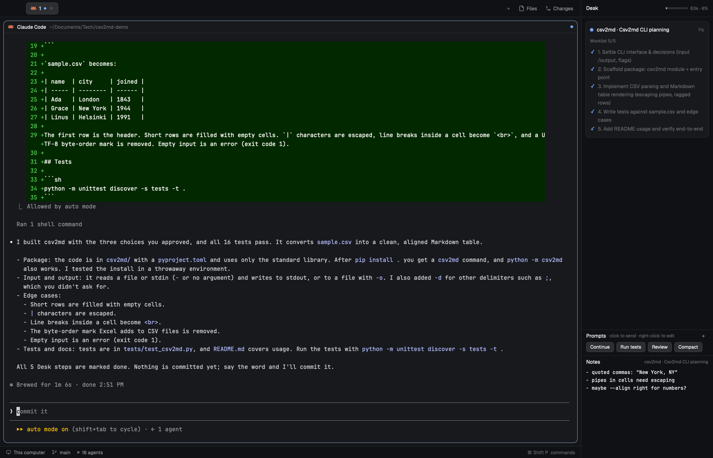
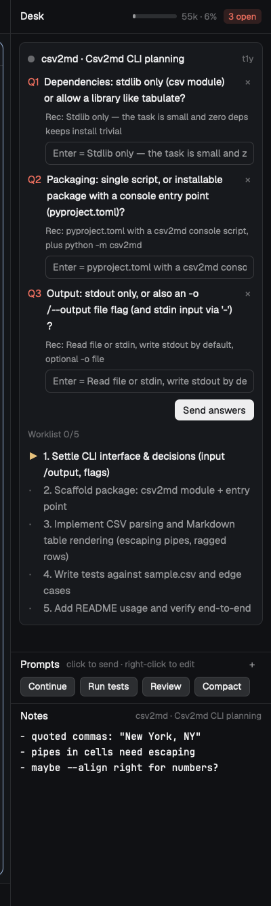

# Desk — a Herdr mod

**Your agents ask, you answer in a box, they carry on.** Desk is a panel for [Herdr](https://herdr.dev) that shows the agent you're on: the decisions it's waiting on you for (each with its recommendation), the worklist it's working through, one-click prompts, a notes area for your own ideas, and how full its context is.


## Why

When you run many agents at once, their questions get buried in the scrollback and you lose track of what each one is doing. Desk gives each agent one place for both, without costing the agent anything:

- **Almost no tokens.** Agents post with a tiny `desk` shell command that prints `ok`. No MCP server, no tool schemas in every session, no polling. In the demo above, the agent posted its plan and all three questions with **one shell command**.
- **Answers flow back by themselves.** Type an answer, or press Enter to accept the agent's recommendation. Desk types `Desk answers: Q1 …: … | Q2 …: …` into the agent's terminal, and it continues.
- **Any agent.** Claude Code, Codex, pi, or anything else that runs in a Herdr terminal and can run a shell command.



## What's on the panel

| | |
|---|---|
| **Questions** | Each with the agent's recommendation and an answer box. Empty + Enter = accept the recommendation. One **Send answers** sends them all. `×` drops a question, **Clear all** drops them all (say, after you answered in chat). |
| **Worklist** | `✓` done, `▶` in progress, `·` open. Click an item to tick it yourself. |
| **Prompts** | Buttons that type a prompt or `/skill` into the agent and press Enter. **+** adds one (a label and the prompt), right-click edits or deletes it. Shared by all agents. |
| **Notes** | Your own scratchpad per agent, saved automatically. The agent never sees it. |
| **Context gauge** | In the header, for Claude Code agents: how full the context is (`55k · 6%`), amber from 70 %, red from 85 %. |

Everything follows the agent you're on: switch agents and the Desk switches with you. Drag the line above **Prompts** to share the height between the cards and the prompts and notes.



## Install

The easy way, in Herdr, ask any agent:

```
Read ~/.config/herdr-app/AGENTS.md, then add this mod: herdr.dev/mods/CMehlstaeubler/desk
```

Or by hand:

```sh
git clone https://github.com/CMehlstaeubler/herdr-desk
cp -r herdr-desk/mods/desk ~/.config/herdr-app/mods/
ln -s ~/.config/herdr-app/mods/desk/desk ~/.local/bin/desk   # any folder on your PATH
herdr-app check ~/.config/herdr-app/mods/desk
```

Then tell your agents about it. Add this to their instructions (Claude Code: `~/.claude/CLAUDE.md`, Codex: `~/.codex/AGENTS.md`):

```markdown
## Herdr desk
Inside Herdr (`$HC_TERMINAL_ID` set), post to the person's Desk panel with the `desk` CLI; it prints `ok`, don't read it back.
- Every question that waits on their decision goes through `desk ask`, all of them in one call, each with your recommendation: `desk ask "First?" --rec "your pick" "Second?" --rec "your pick"`. In chat, end with one line ("2 questions in the Desk") instead of repeating them. Their answers arrive as a prompt starting "Desk answers:". When they answer one in chat instead, or it no longer matters, `desk close N` (ids from `desk ask`'s output; `desk show` lists them).
- Work of 3+ steps: `desk list "Step" ...` once, then `desk doing N` / `desk done N` as you go; when the plan changes, `desk set N "text"`, `desk add`, `desk rm N`. No other updates.
```

Make it **the** way to ask, not an extra step: an agent told to ask "also" in the Desk asks in chat and forgets the Desk. If your project's own instructions say how to ask (in chat, in a queue), change them to match, or they win. Agents that were already running pick it up after a restart.

## The CLI

```sh
desk ask "Question?" --rec "your pick" ["Another?" --rec "…" …]   # prints "ok Q4 Q5"
desk close 4 5   |   desk close all   # remove questions answered in chat, or moot
desk list "Step" "Step" …        # replace the worklist
desk add "Step" …                # append
desk set 2 "New text"            # reword an item
desk rm 4                        # remove an item; the others keep their numbers
desk doing 3                     # one item in progress at a time
desk done 1 2   |   desk skip 4
desk clear [questions|list]
desk show                        # print the state
```

Python 3, standard library only. Outside Herdr it does nothing and still prints `ok`, so the instructions are safe everywhere.

## Settings

- **Prompts:** `~/.config/herdr-app/desk-prompts/prompts.json`, a list of `{ "label": "…", "text": "…" }`. The panel edits it for you; a hand edit shows at once. The first start writes three starters (`continue`, `/compact`, "What's left?").
- **Context window:** the gauge assumes 200k (1M once an agent is past 200k). If your plan has a 1M window, create `~/.config/herdr-app/desk.json` with `{ "contextWindow": 1000000 }`.

## How it works

`desk` writes one JSON file per terminal (`$HC_TERMINAL_ID`) to `~/.config/herdr-app/desk/`. The panel watches that folder and draws the file of the agent you're on. Answers and prompts go out with `hc send <terminal> "…"`. Notes live in `~/.config/herdr-app/desk-notes/`. The gauge reads the last turn's token usage from the end of the agent's Claude Code log (`~/.claude/projects/…`). Files of terminals that are gone are cleaned up.

The mod runs `hc send` (it types into your agents' terminals), runs `tail` on Claude Code logs, and writes only under `~/.config/herdr-app/`. No network.

## Limits

- macOS and Linux: the CLI needs `python3` and the gauge `tail`. Windows is untested.
- Agents on other machines (`hc machine`) write their files there, so they don't show yet.
- The gauge works for Claude Code agents only; for others the header stays empty.
- An agent that posts a question and ends its turn shows as *done*, not *blocked*: you see its questions when you go to it.

[RECIPE.md](RECIPE.md) is the full brief to rebuild Desk from scratch.

## License

MIT, see [LICENSE](LICENSE).
