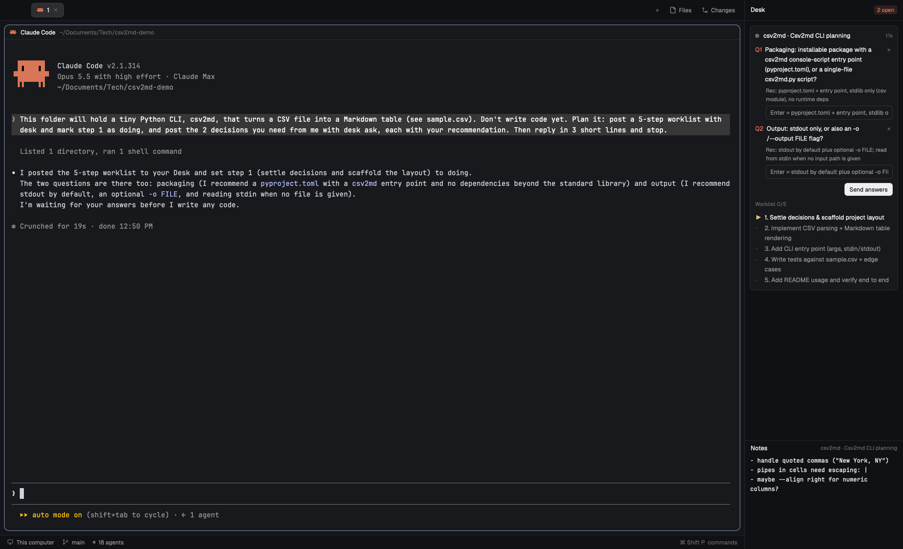

# Desk

A panel on the right of the window for the agent you're on: the questions it is waiting on you for, each with an answer box and its recommendation; the worklist it is working through; one-click prompt buttons; a notes area for your own ideas about that agent; and, for Claude Code agents, how full its context is. Agents post with a tiny `desk` shell command that prints `ok`, so it costs them almost no tokens; your answers go back as one typed prompt, so nothing polls. Works with any agent that runs in a Herdr terminal (Claude Code, Codex, pi, …).



## What you see

Top to bottom, in a 340px column docked right (`mod.json`: `place: "right"`, `size: 340`), background `chrome`, text 12.5px:

1. **Header**, 42px tall (same as the main layout's tab bar, so the bottom borders line up), `border_b` 1px `border`. "Desk" in semibold on the left; on the right:
   - for a Claude Code agent, the **context gauge**: a 54×5px bar (radius 3, `raised` track, fill in `muted`, `working` from 70 %, `blocked` from 85 %) and "<tokens> · <percent>" in 11px (`dim`, or the fill color from 70 %), e.g. "55k · 6%";
   - when the agent has open questions, a pill "N open": `blocked` text on `blocked` + `26` alpha, 18px tall, radius 5, 11px semibold.
2. **Error line** (only after a failed send or save): 11px, `ansi1`.
3. **Card area**, scrollable (`overflow_y_scrollbar`), padding 10. One card for the agent you're on, or the dim line "No questions or worklist from this agent." Card: `surface`, 1px `border`, radius 8, padding 10, gap 8:
   - **Agent row**: an 8px status dot in the theme color of its status (`working`, `blocked`, `done`, `idle`), the name "<space> · <terminal title or tab name>" in semibold (truncated), and the terminal address (`t1q`) in 11px `dim` on the right.
   - **Questions**: "Q<id>" in `blocked` semibold, the question text, and a dim "×" on the right. Under it, when there is one, "Rec: <recommendation>" in 11px `muted`, then an answer box: 28px tall, radius 6, 1px `input` border, `background` fill, 12px text; its placeholder is "Enter = <recommendation>" (clipped to 40 characters) or "Answer…".
   - A row under the questions: **Clear all** on the left (11px `dim`, `hover` fill, radius 5), the **Send answers** button on the right, 26px, radius 6, 12px semibold: `solid` / `solid_foreground` when at least one question has a typed answer or a recommendation, else `raised` / `dim`.
   - **Worklist**: "Worklist <done>/<total>" in 11px `dim`, then one row per item: a mark (`✓` in `done`, `▶` in `working`, `·` in `dim`, `–` for skipped) and "<n>. <text>". The item in progress is semibold `foreground`, open ones `muted`, done and skipped ones `dim`.
4. **Divider**, 6px tall, `border_b` 1px `border`, row-resize cursor, `hover` fill: dragging it sets the height of everything below it (default 300px, at least 120px, at most the panel's height minus 140px).
5. **Prompts**: a 30px header row with "Prompts" in semibold, a hint in 11px `dim` ("click to send · right-click to edit", or "sent “<label>”" after a send) and a 22px **+** button on the right (**×** while the form is open). Below, the buttons wrap: each 24px tall, padding 9, radius 6, `raised` fill, 1px `border` (`input` on hover, `accent` while it is being edited), 11.5px label.
   - **The form** (open from **+** or by right-clicking a button), a card in `surface` with 1px `border`, radius 8, padding 8: a heading "New button" / "Edit button" (11px semibold), then two full-width fields one under the other, each with a caption above it in 10.5px semibold `muted`: "Label (on the button)" (placeholder "e.g. Ship it") and "Prompt (sent to the agent)" (placeholder "e.g. /review or a sentence"); a hint "Enter saves · empty label = the prompt's first words" in 10.5px `dim`; and a row of 24px buttons: **Delete** (`blocked` on `blocked` + `22`, only when editing) on the left, **Cancel** (`muted` on `raised`) and **Add** / **Save** (`solid`) on the right.
6. **Notes**, filling what is left of the bottom part, `border_t` 1px `border`: a 30px header row with "Notes" in semibold and the agent's name in 11px `dim` on the right, then a markdown editor (no line numbers, no folding, soft wrap, the person's terminal font at 12px).

## How it behaves

- **Only the agent you're on.** Questions, worklist and notes all follow `focused().terminal` (falling back to the focused agent). While focus is inside the Desk itself (typing an answer or a note), the last agent stays.
- **Agents post** by running `desk` in their shell. The CLI finds its terminal through `$HC_TERMINAL_ID` (set by herdr-core in every terminal) and writes `~/.config/herdr-app/desk/<terminal>.json`. The panel watches that folder with `watchFolder`, so a post shows within a moment and nothing polls.
- **Answering:** type in a question's box, or leave it empty to accept the recommendation. Enter in any box, or **Send answers**, sends every answered question of that agent as one line typed into its terminal with `hc send`: `Desk answers: Q1 "<question, max 80 chars>": <answer> | Q2 "…": <recommendation> (your recommendation)`. The agent reads it as a normal prompt; mid-turn, Claude Code takes it as a message during the turn. Sent questions are removed from the file. A question with neither a typed answer nor a recommendation is not sent.
- **×** drops a question without answering; **Clear all** drops all of the agent's questions (for answers given in chat). Agents do the same with `desk close`.
- **Clicking a worklist item** ticks it: open or in progress becomes done, done or skipped becomes open (the person's override; the agent's next `desk` call can change it again).
- **Clicking the agent row** runs `agent.focus {terminal}`.
- **Prompts:** a click types the button's prompt into the agent you're on with `hc send` (paste + Enter), so `/skills` run too. Right-click opens the form filled with that button; Enter in either field or **Save** stores it, **Delete** removes it. Without a label, the prompt names its button (first 24 characters). The buttons are shared by all agents and live in `~/.config/herdr-app/desk-prompts/prompts.json` (`[{ "label", "text" }]`); the first start writes three starters (`continue`, `/compact`, "What's left?"), and a hand edit of the file shows at once.
- **Divider:** the height is kept in the mod's `localStorage` (`bottomH`), so it survives restarts. The drag ends on mouse-up or when the pointer leaves the panel.
- **Context gauge:** when you switch agents and every 20s, the mod finds the agent's Claude Code log (terminal → `hc get` foreground pid → `~/.claude/sessions/<pid>.json` → session id and cwd → `~/.claude/projects/<cwd with every non-alphanumeric character as "-">/<session id>.jsonl`), reads its last 400 KB with `tail -c`, and takes the last main-loop assistant message with `usage` (`isSidechain` false): input + cache read + cache creation tokens. The window is `contextWindow` from `~/.config/herdr-app/desk.json` when set, else 200k, or 1M once an agent is past 200k. Other agents show no gauge.
- **Notes** save on their own, at most every 0.8s, to `~/.config/herdr-app/desk-notes/<terminal>.md`; an emptied note deletes its file. Switching agents switches the note. The agent never sees notes.
- **Cleanup:** files in `desk/` and `desk-notes/` of terminals that no longer exist are deleted (only when `terminals()` is non-empty, so a slow start never wipes anything).
- No sounds, no toasts.

## Built from

- **Layout:** none. The mod docks itself on first sight via `mod.json` `{ "place": "right", "size": 340, "title": "Desk" }`.
- **`mods/desk/main.js`**, one `View`:
  - `herdr`: `agents()`, `terminals()`, `focused()`, `theme()`, `settings()`, `appHome()`, `home()`, `readTextFile`, `writeTextFile` (with the text last read as `expected`; retried up to 3 times when the CLI wrote in between), `watchFolder` (on `desk/` and on `desk-prompts/`), `hc(["send", terminal, text])`, `hc(["get", terminal])`, `exec("tail", ["-c", "400000", log])`, `run("agent.focus", { terminal })`.
  - `gpui-base`: `v_flex`, `h_flex`, `InputState` + `Input` (one per question, created when its question first loads, released after sending; two more for the prompt form), `EditorState` + `Editor` (the note).
  - `fs/promises`: `readdir`, `mkdir`, `unlink`. `localStorage` for the divider height.
  - Root element: `on_size_change` (panel height, for the divider's maximum), `on_mouse_move` / `on_mouse_up` / `on_hover` (the drag).
  - Timers: `cx.timer.every(800)` flushes the note, `cx.timer.every(20000)` measures the context.
- **`mods/desk/desk`**, the CLI (Python 3, standard library only), linked onto PATH: `ln -s ~/.config/herdr-app/mods/desk/desk ~/.local/bin/desk`.
  - `desk ask "Question?" [--rec "pick"] ["Another?" …]`: `--rec` belongs to the question before it; ids count up per terminal; prints `ok Q4 Q5`, the new ids.
  - `desk close N…` (also `Q4`) removes questions, `desk close all` all of them; an unknown id exits 2.
  - `desk list "Topic" …` replaces the worklist; `desk add "Topic" …` appends; `desk set N "text"` rewords an item; `desk rm N…` removes items, the others keep their numbers.
  - `desk doing N` (at most one item in progress), `desk done N…`, `desk skip N…`.
  - `desk clear [questions|list]`, `desk show` (prints the state, for an agent that lost track).
  - Prints `ok` (after `ask`, plus the new ids) and nothing else. Outside Herdr (`$HC_TERMINAL_ID` unset) it writes nothing and prints `ok (not in Herdr: nothing shown)`. Bad input exits 2 with one line on stderr.
  - Writes atomically (temporary file + rename). File shape: `{ terminal, cwd, updated, next_q, questions: [{ id, text, rec?, at }], list: [{ n, text, status: "open"|"doing"|"done"|"skipped" }] }`.
- **The agents' instructions**: add these lines to the agent's own instructions (for Claude Code `~/.claude/CLAUDE.md`, for Codex `~/.codex/AGENTS.md`):

  ```
  ## Herdr desk
  Inside Herdr (`$HC_TERMINAL_ID` set), post to the person's Desk panel with the `desk` CLI; it prints `ok`, don't read it back.
  - Every question that waits on their decision goes through `desk ask`, all of them in one call, each with your recommendation: `desk ask "First?" --rec "your pick" "Second?" --rec "your pick"`. Each Desk question stands on its own: the case, the options and your pick, so it can be answered from the Desk alone. In chat, report what you did and found, but don't lay out the options or the question again. End the chat with one line ("2 questions in the Desk"). No question dialog (Claude Code's AskUserQuestion). Their answers arrive as a prompt starting "Desk answers:". When they answer one in chat instead, or it no longer matters, `desk close N` (ids from `desk ask`'s output; `desk show` lists them).
  - Work of 3+ steps: `desk list "Step" ...` once, then `desk doing N` / `desk done N` as you go; when the plan changes, `desk set N "text"`, `desk add`, `desk rm N`. No other updates.
  ```
- No `keys.json`.

## Watch out

- **Runs programs and writes files:** the mod runs `hc send` (types into your agents' terminals) and `tail` (reads Claude Code logs under `~/.claude/projects/`), and writes under `~/.config/herdr-app/desk/`, `desk-notes/` and `desk-prompts/`. No network.
- **The instruction must make `desk ask` the way to ask**, not an extra step: told to ask "also" in the Desk, agents ask in chat and forget it. A project's own instructions about asking (in chat, in a queue) win over a global line, so change them too.
- Give the prompts **their own folder**: watching `~/.config/herdr-app` itself, which Herdr writes all the time, stalls the mod's other tasks (the notes stay on "Loading note…").
- `on_mouse_move` only arrives while the pointer is over the element, and carries no button state: end the drag on mouse-up and when the pointer leaves the panel.
- Claude Code logs run to hundreds of MB and `readTextFile` stops at 1 MiB: read only the tail. The cwd → folder rule replaces every character that isn't a letter or digit with `-`.
- macOS and Linux only: the CLI needs `python3`, the gauge `tail`.
- Answers go out as **one line**: `hc send` pastes and presses Enter, and a newline would submit early in some agents. Whitespace in answers is collapsed.
- Keep notes **out of** the watched `desk/` folder: every note save would otherwise trigger a reload.
- `focused().terminal` is null while focus is in a mod; keep the last agent, or the Desk empties as soon as you click into an answer box.
- Create `InputState` and `EditorState` in `init` or a `cx.spawn` callback, never in `render`.
- **Agents on other machines** (`hc machine`) run the CLI there, so their files land on that machine and don't show. Only this computer's agents for now.
- Agents running before the instruction lines were added need a restart to use `desk`.
- An agent that posts a question and ends its turn shows as `done`, not `blocked`; you see its questions when you go to it.

## Done when

- `herdr-app check ~/.config/herdr-app/mods/desk` passes and the Desk docks on the right.
- In an agent's terminal, `desk ask "Test?" --rec "Yes"` prints `ok`, and while you're on that agent the card shows Q1 with "Rec: Yes".
- Pressing Enter in the empty box types `Desk answers: Q1 "Test?": Yes (your recommendation)` into that terminal, and Q1 disappears.
- `desk list "A" "B" "C"; desk done 1; desk doing 2` shows `✓ 1. A`, `▶ 2. B` in semibold, `· 3. C`, and "Worklist 1/3".
- Switching to another agent shows that agent's card and note instead; switching back brings the first ones back.
- `desk ask "A?" "B?"` prints `ok Q1 Q2`; `desk close 1` leaves only Q2 in the card; **Clear all** empties it.
- Text typed in Notes is still there after switching agents and back, and is in `~/.config/herdr-app/desk-notes/<terminal>.md`.
- The Desk header's bottom border lines up with the tab bar's.
- On a Claude Code agent the header shows the gauge, e.g. "55k · 6%"; on a shell it shows none.
- Clicking a prompt button types its prompt into the agent and the hint says "sent “<label>”". Right-click → change the label → Enter renames it; **Delete** removes it; both show in `desk-prompts/prompts.json`. Editing that file by hand changes the buttons within a second.
- Dragging the divider up and down resizes the prompts and notes; the height is the same after switching agents and after a restart.
